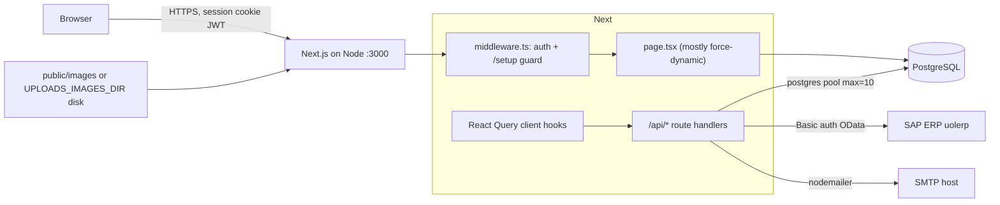

# System Design Context — UOL Alumni Portal

> Source of truth for a future performance-improvement pass.
> Every claim below cites a file read during a code scan. Facts that could not be
> verified from the repository are marked `UNVERIFIED`.
> No secrets, credentials, or env values are reproduced — variable names only.

---

## 1. Overview

Alumni management portal for the University of Lahore. Serves two audiences:

- **Alumni** — self-registration (public), profile management, alumni card
  application, scholarship applications (kinship / masters-PhD / general),
  facility memberships (gym, swimming pool, cricket club), chapters and
  association participation, success stories, alumni talks.
- **Staff** — admin dashboard with tabbed alumni directory (verified /
  under-approval / categories / medalists / distinguished), deep master-filter
  panel (~30 filter dimensions), card processing workflow, scholarship review,
  membership review, leadership application assessment, analytics command
  center, bulk Excel import, email actions, ERP (SAP) data comparison, user &
  access management (`/setup`).

Roles: `superadmin`, `admin`, `viewer` (legacy `user` normalized to `viewer`),
`alumni`. Enforcement lives in `src/lib/alumniProfile.ts` (`isSuperAdminUser`,
`isAdminUser`, `isViewerUser`, `canModify`) and `src/lib/rbac.ts` /
`src/lib/userAccess.ts`.

Scale: `UNVERIFIED` — no seeds or comments reveal row counts. `tbl_alumni` has
~80 columns; `src/app/api` contains ~150 route handlers. The export route
comments suggest datasets in the tens of thousands
(`src/app/api/alumni/export/route.ts` line ~1011 logs when `rows.length > 50000`).

---

## 2. Tech Stack and Versions

From `package.json` (exact versions as installed):

| Area | Choice | Version |
|---|---|---|
| Framework | Next.js App Router | 15.3.6 |
| UI | React | 19.2.0 |
| Language | TypeScript | 5 |
| Auth | NextAuth | 5.0.0-beta.30 |
| DB driver | `postgres` (porsager) | ^3.4.7 |
| Data fetching | @tanstack/react-query | ^5.90.7 |
| Mail | nodemailer | ^7.0.10 |
| Excel | xlsx | ^0.18.5 |
| PDF | jspdf (client-side) | ^3.0.4 |
| CSS | Tailwind 4 + @tailwindcss/postcss | 4 |
| Validation | zod, react-hook-form | — |
| Misc | lucide-react, react-hot-toast, apexcharts, recharts, @bprogress/react, fullcalendar, motion | — |

**Important:** despite a `NEXT_PUBLIC_*`-heavy config there is **no Supabase
client**; database access is raw SQL via `postgres` in `src/lib/dbconnect.ts`.
Scripts: `dev` (`next dev -p 3000`), `build`, `start`, `test: vitest run`,
plus `tsx` scripts for ERP import (`scripts/fetch-erp-update-alumni.ts` etc.).

`next.config.mjs`: loads dotenv at config time, reads
`NEXT_PUBLIC_IMAGE_DOMAINS`, `eslint.ignoreDuringBuilds = true`, TypeScript
errors NOT ignored, remote image domains, `@svgr/webpack` loader with
`svgo: false`.

---

## 3. Architecture Map

```
repo root
├─ app.js                    # Plesk custom-server entry (createServer + next)
├─ middleware.ts             # NextAuth session gate + /setup superadmin guard
├─ next.config.mjs
├─ schema.sql                # monolithic schema snapshot (~1400 lines)
├─ migrations/               # ~80 numbered SQL migrations + RBAC docs
├─ scripts/                  # tsx ops scripts (ERP fetch, index creation, checks)
├─ deploy/                   # nginx example (event images → Node)
├─ DEPLOYMENT.md             # Plesk/nginx/PM2 notes (no PM2 config file found)
└─ src/
   ├─ app/
   │  ├─ layout.tsx          # server shell → <Providers>
   │  ├─ providers.tsx       # client: SessionProvider + QueryClient + 401 fetch interceptor
   │  ├─ (admin)/            # admin pages (dashboard, others-pages/*, ui-elements)
   │  ├─ (full-width-pages)/ # signin, alumni-registration, alumni-verification, 404
   │  ├─ alumni-profile/     # alumni self-service pages (~25 pages, all force-dynamic)
   │  ├─ api/                # ~150 route handlers (REST, no server actions)
   │  └─ queries/            # ~50 React Query hooks/fetchers ("use client")
   ├─ auth/credentials.ts    # staff+alumni credential verification
   ├─ components/            # ~20 feature folders (alumni, analytics, setup, ...)
   ├─ context/               # SidebarContext, ThemeContext
   ├─ layout/                # UnifiedHeader, AppHeader
   ├─ lib/                   # dbconnect, auth, rbac, userAccess, master-filter-utils,
   │                         # email(+Logs/Templates), erpClient, bulk-upload*, pdf*,
   │                         # upload helpers, adminActivityLog, loginLog
   ├─ services/              # thin client wrappers (alumniService.ts)
   └─ icons/, svg/, utils/
```

No Next.js Server Actions — mutations go through `POST/PUT/PATCH/DELETE` route
handlers. No `pages/` directory.



---

## 4. Rendering and Data-Fetching Strategy

Pattern is consistent: thin **`export const dynamic = "force-dynamic"`** server
`page.tsx` that calls `auth()` for a role gate, then renders client components
that fetch everything through TanStack Query (`src/app/providers.tsx` mounts
one `QueryClientProvider`). No ISR/SSG — `git grep revalidate|unstable_cache`
finds only `force-dynamic` and one `maxDuration = 600` on the export route.

| Page | Rendering | Data path |
|---|---|---|
| `(admin)/dashboard/page.tsx` | force-dynamic server page, `auth()` then role check | `AlumniTabbedMenu` → `UnifiedHeader` tabs; `DashboardStats` → `/api/dashboard/alumni-trends`; KPIs → `/api/analytics/kpis` |
| `(admin)/(others-pages)/alumni/page.tsx` | `"use client"` | `AlumniTabs` (6,089-line client component) → `useAlumniListPaginated` + `getAlumniCounts` + ~25 filter-option hooks |
| `(admin)/(others-pages)/admin/analytics/page.tsx` | server page, auth+role gate | `AnalyticsDashboardClient` → `useCommandCenterData` → `/api/analytics/realtime-dashboard` |
| `alumni-profile/page.tsx` | force-dynamic server component | Runs several direct `sql` queries in `getProfile()` server-side AND client components (`ProfileDetailsClient`, `ProfileDetailsServer`) also call `useAlumniFullDetails` |
| `alumni-profile/card`, `scholarship-application`, memberships, `more-details`, `upskill-application` | force-dynamic shells | `useAlumniFullDetails` → `/api/alumni/[sapid]/full-details` |
| `(admin)/(others-pages)/alumni-stories`, `events`, `leadership`, `setup` | force-dynamic | client fetches to `/api/*` |
| `(full-width-pages)/(auth)/signin`, `alumni-registration`, `alumni-verification` | public, excluded in `middleware.ts` | client forms → `/api/*` |

React Query settings (representative):
- `useAlumniListPaginated` — `staleTime` 5 min, `gcTime` 30 min,
  `placeholderData: prev`, `refetchOnWindowFocus:false`
  (`src/app/queries/fetch-alumni.ts`).
- `useAlumniFullDetails` — `staleTime` 1 min (`src/app/queries/alumni-profile.ts`).
- Master-filter hooks (e.g. `useEmployers`) — `staleTime` 2 min, `retry: 2`,
  queryKey embeds the full `MasterFilters` object so **every filter change
  issues new requests** (`src/app/queries/fetch-employers.ts`).
- `useCommandCenterData` — `staleTime` 30 s, **`refetchInterval: 30_000`,
  `refetchOnWindowFocus: true`**
  (`src/components/analytics/command-center/hooks/useCommandCenterData.ts`).
- `useCardApplicants` — `staleTime` 60 s, `cache: "no-store"` fetch
  (`src/app/queries/fetch-card-applicants.ts`).

Caching elsewhere: one module-level 5-minute cache
(`getAllFacultyNamesCached`, `src/lib/orgAccessLookup.ts`), an in-memory login
rate-limit `Map` (`src/auth/credentials.ts`), a cached nodemailer transporter
(`src/lib/email.ts`), and an in-memory parsed-upload store with TTL
(`src/lib/bulk-upload-store.ts`). `src/lib/alumniCache.ts` is client-side list
transformation, not a server cache. HTTP `Cache-Control` is only set on
`card-profile-image` (`no-store`). No CDN/edge caching.

---

## 5. Database Design

### Client

`src/lib/dbconnect.ts` — lazy singleton `postgres` client behind a `Proxy`
(init deferred to first call so builds don't require `DATABASE_URL`).
Pool: `max: 10`, `idle_timeout: 20`, `connect_timeout: 30`,
`max_lifetime: 30 min`, `prepare: false` (prepared statements disabled —
required for PgBouncer-style poolers, but every query is re-parsed).
`retryDbOperation()` retries **only** connection-timeout errors with 1s/2s/4s
backoff; used in a handful of routes (counts, some lookups), not globally.
Transactions exist but are rare (`sql.begin` in `api/alumni/talks` POST);
most multi-statement handlers are not transactional.

### Core tables (`schema.sql`, `migrations/`)

| Table | Role | Notes |
|---|---|---|
| `tbl_alumni` | master record, ~80 columns | PK `alumniid`; FK `faculty→tbl_faculties`, `department→tbl_departments`, `program→tbl_programs`, plus legacy duplicated text columns (`facultyname`, `departmentname`, `degreetitle`). Passwords stored as `password text` (plaintext-compatible; see `verifyPassword`). `verify` is a free-text status. |
| `alumni_chapter` | 1:1 chapter assignment (`chapter1/2/3` → `tblchapters`) | PK = alumniid FK |
| `tblchapters` | national/international chapters | `cities` text parsed in JS (`parseChapterCities`) |
| `tblcard` | alumni card application | PK `alumniid`, `status` varchar (UnderReview/UnderPrinting/Active/Onhold/Returned/Delivered + legacy Pending/Process) |
| `alumni_scholarships` | scholarship application | PK `id` FK→alumni; JSONB `kinship_details`, `masters_details`, `uploaded_documents`; `status` text; `applied_discount_percent` |
| `alumni_memberships` | facility memberships | same pattern, `application_details` JSONB |
| `scholarship_discount_categories` + `scholarship_cgpa_discount_tiers` | dynamic discount config | tiers carry `grade_type` (cgpa\|percentage) from migration 072; index on `category_id` |
| `scholarship_form_settings`, `membership_settings` | form toggles | |
| `chapter_leadership`, `leadership_roles`, `leadership_role_criteria`, `leadership_criteria_confirmations`, `leadership_form_settings`, `leadership_recommendations` | leadership assessment workflow | indexed on FKs |
| `distinguished_alumni` | curated alumni | FK to faculty/department/program |
| `tbl_faculties`, `tbl_departments`, `tbl_programs` | org hierarchy | `programs.department_id→departments`, `departments.faculty_id→faculties` |
| `tbl_events`, `tblalumnistories`, `tbljobs`, `newsletters`, `alumni_talk_sessions`, `alumni_birthdays`, `merchants`, `ucoming_events`, `tblstories`, `tblalumnitalks`, `tblalumniassociation`, `alumnichapterslocation`, `tbl_users`, `tblcard`, `tbl_courses` | feature tables | several legacy duplicates (e.g. `tbl_users` vs `users`) |
| `users`, `roles`, `permissions`, `role_permissions`, `user_roles`, `resources`, `user_resource_access` | **new** RBAC (migrations 001–003) | indexes exist on email/legacy_userid/is_active and all RBAC FKs |
| `user_access_assignments` | **old** RBAC | still queried at runtime via `information_schema` existence checks (`src/lib/userAccess.ts`, `src/lib/rbac.ts`) |
| `admin_activity_logs`, `login_logs`, `email_logs` | audit trails | indexed on created_at/actor |
| `tbl_alumni_change_requests` | pending profile changes | indexed on alumni_id/status |
| `staging_alumni_import` | bulk-upload staging | **created in schema but never referenced in `src/`** — parsed uploads live in the in-memory `bulk-upload-store` instead |
| `mock-programs.json`-backed matching | `src/lib/programMatching.ts` reads a JSON snapshot of program names for fuzzy matching | |

### Indexes

`schema.sql` declares indexes only for: `alumni_birthdays.created_at`,
`tbl_alumni_change_requests`, `scholarship_cgpa_discount_tiers.category_id`,
`user_access_assignments` (6 indexes), `users` (email/is_active/legacy_userid),
`alumni_talk_sessions`, `tblalumnistories.status`, `merchants`,
`story_criteria(_responses)`, leadership tables, and the RBAC tables.

**`tbl_alumni` has only its PK** plus (optionally) the unapplied
`scripts/add-alumni-indexes.sql` (sapid, alumniid DESC, verify, login cols,
emails, alumniname). Even if applied, those plain-column indexes do **not**
match the `LOWER(TRIM(COALESCE(col,'')))` predicates used everywhere.
`UNVERIFIED` whether that script ran in production.

No runtime `CREATE/ALTER TABLE` in `src/` — only defensive
`information_schema.tables` existence probes
(`userAccess.ts`, `rbac.ts`, `submissions/bulk-edit/route.ts`).

---

## 6. Auth and RBAC

`src/lib/auth.ts` — NextAuth v5 with two providers:

- **Google OAuth** (`AUTH_GOOGLE_ID/SECRET` or `GOOGLE_CLIENT_ID/SECRET`):
  allowed only if the email exists in `public.users` (staff).
- **Credentials** (`src/auth/credentials.ts`): identifier = email (staff,
  `users` table, scrypt `password_hash` via `verifyAdminPassword` or legacy
  plaintext `password`) or SAP ID / registration number (alumni,
  `tbl_alumni`, **plaintext comparison** via `verifyPassword` — normalizes
  whitespace, compares strings/bytes directly). Alumni login tries
  `sapid` match first then `registrationno`, each with
  `REGEXP_REPLACE(...)`-normalized comparisons — both are full scans.
  In-memory rate limit: 5 attempts / 5 min per `identifier|ip` (per-process).
  `verify='underApproval'` alumni are blocked at login.
- Session: **JWT, `maxAge` 1 hour**, `session.strategy="jwt"`,
  `pages.signIn="/signin"`, `secret = AUTH_SECRET || NEXTAUTH_SECRET`.
- **`jwt` callback performs a DB refresh on every `auth()` call** —
  for alumni it queries `tbl_alumni` (+departments join) by
  alumniid/sapid/registrationno; for staff it queries `users`. This is +1–2
  DB round-trips per authenticated request and per middleware invocation.

`middleware.ts` — `auth()` gate on all non-matched paths; unauthenticated →
`/signin?callbackUrl=…`; `/setup` and `/setup/*` → `isSuperAdminUser`;
`/alumni-registration` and `/alumni-verification` are public.

RBAC is **dual-layer**:
- New: `user_resource_access` + `resources` hierarchy
  (`buildIdBasedAccessFilterSQL`, `src/lib/rbac.ts`).
- Legacy: `user_access_assignments`
  (`buildAccessFilterSQL`, `src/lib/userAccess.ts`, marked `@deprecated`).

`buildAccessFilterSQL` runs on nearly every alumni-scoped API request and
executes 3–6 sequential queries itself (user lookup, `information_schema`
existence probe, `ura` join, `user_access_assignments`, faculty list — the
last one cached 5 min). Fallback rules mean "no assignments ⇒ full access"
in most paths; a `1=0` deny only appears in a few branches.
Per-route authorization varies: most handlers check `session` +
`canModify`/`canViewAlumni`/`isSuperAdminUser`; some (e.g.
`api/alumni` GET) allow any session; `/setup` is enforced both by middleware
and inside handlers.

---

## 7. Feature Modules

### 7.1 Admin dashboard
- Page: `src/app/(admin)/dashboard/page.tsx` → `AlumniTabbedMenu` → `UnifiedHeader`.
- Widgets: `components/dashboard/DashboardStats.tsx` → `GET /api/dashboard/alumni-trends`,
  `api/analytics/kpis` (4 `COUNT(*)` queries, `src/app/api/analytics/kpis/route.ts`).

### 7.2 Alumni directory + master filters
- `GET /api/alumni` (`src/app/api/alumni/route.ts`, ~2,000 lines):
  pagination (`limit` ≤ 500), 10-way `LIKE '%…%'` search, ~30 dynamic filter
  dimensions built as `LOWER(TRIM(COALESCE(col,''))) = LOWER(TRIM($v))`
  conditions + `verify`/`category`/`medal`/state (NULL/EXISTS/DUPLICATE)
  filters. Sortable via `ALLOWED_SORTS` but `ORDER BY LOWER(COALESCE(...))`.
  `countsOnly=true` returns a bare `COUNT(*)`.
- `GET /api/alumni/counts` (`…/counts/route.ts`, ~1,400 lines): one aggregate
  query with `COUNT(*) FILTER (…)` for all tab badges + a second query for
  `distinguished_alumni`.
- ~25 option endpoints (`employers`, `home-cities`, `sectors`, `provinces`,
  `institution-names`, …, e.g. `src/app/api/alumni/employers/route.ts`):
  each does `GROUP BY <expression>, COUNT(*)` on `tbl_alumni` with every other
  filter applied via `buildMasterFilterConditions` (`src/lib/master-filter-utils.ts`).
- `AlumniTabs` mounts ~25 of these hooks simultaneously with
  `queryKey: ["<dim>", masterFilters]` → **each filter interaction re-fires
  ~25 aggregation queries**.

### 7.3 Export
`GET /api/alumni/export` (`…/export/route.ts`, `maxDuration=600`): `SELECT a.*`
+ ~12 LEFT JOINs (faculties/departments/programs/chapters×3/association/
leadership/memberships/scholarships), same ~30 filter dims, **no LIMIT** —
returns the full result set as JSON; `DEPLOYMENT.md` documents 900 s nginx
timeouts for it. Client builds Excel.

### 7.4 Departments / programs / faculties
`src/app/api/organization/{faculties,departments,programs,chapters}/route.ts` —
CRUD over the org tables. `departments` includes a `for … of assignments`
loop issuing queries per assignment (N+1). DELETE guards use `COUNT(*)`
checks on `tbl_programs`/`tbl_alumni`.

### 7.5 Scholarships
- Apply: `POST /api/alumni/[sapid]/scholarship-application` — multipart form,
  required-file validation (`requiredFiles` incl.
  `kinship-alumni-transcript`), server enum validation for
  `kinshipRelation ∈ {Brother,Sister,Son,Daughter}`, JSONB persistence into
  `kinship_details`.
- Config: `/api/scholarship/categories`, `/api/scholarship/cgpa-tiers`
  (categories + tier bounds with `grade_type`).
- Admin review: `/api/alumni/scholarships/[alumniId]` (21 `await sql` calls —
  sequential multi-step workflow).
- Resolution logic: `src/lib/scholarshipDiscount.ts` (+`.test.ts`).
- PDFs: **client-side** `src/lib/pdfGenerator.ts`, `src/lib/scholarshipLetter.ts` (jspdf).

### 7.6 Alumni cards
`api/alumni-cards/*` (`applicants`, `counts`, `by-sap/[sapid]`, `export`,
`onhold-reasons`): `tblcard ⋈ tbl_alumni` listing; **applicants GET has no
LIMIT** (full join returned each call); counts via `COUNT(*) FILTER`.
Status registry `src/lib/card-status-config.ts`; delivery address helper
`src/lib/cardDeliveryAddress.ts`.

### 7.7 Memberships
`/api/alumni/memberships[...]`, `/api/alumni/gym-membership`,
`swimming-pool-membership`, `cricket-membership`, `/api/membership/*` —
same application + admin review pattern; `alumni_memberships` rows +
`membership_settings`.

### 7.8 Leadership
`/api/leadership/*` — `actions/route.ts` alone issues ~35 sequential `await
sql` calls (assessment/confirm workflow over `leadership_*` tables);
`recommend/route.ts` ~12. Criteria confirmations upserted per criterion in a
loop (`INSERT … ON CONFLICT DO UPDATE` per id).

### 7.9 Filtering infra
`src/lib/master-filter-utils.ts` exports `buildMasterFilterConditions`
(shared by ~25 endpoints) and `buildAlumniPresenceBaseWhere` — which
currently returns `1=1` (base predicate intentionally empty).

### 7.10 Analytics
`GET /api/analytics/realtime-dashboard` (~2,800 lines, **~50 sequential
`await sql` calls** per request — only the first two are `Promise.all`'d):
KPIs, faculty breakdowns, chapter member counts, cards, talks, events,
province aggregation, plus 4 redundant "users by faculty" computations
(URA-only / merged / UAA-only / legacy). Client polls every 30 s + on focus.
`api/analytics` (trends) is also polled at 30 s.

### 7.11 Bulk Excel/CSV upload
`/api/bulk-upload/{parse,validate,import,columns}` + `src/lib/bulk-upload.ts`:
xlsx parse → in-memory store (`bulk-upload-store.ts`, per-process `Map`, TTL)
→ `validateRecords` (FK lookups preloaded once via 5 queries) →
`importRecords` — **row-by-row `INSERT` in a JS loop, no transaction, no
batching**; per-row errors collected. Limits: 50 MB, 50 000 rows.
`staging_alumni_import` table is unused.

### 7.12 Automated emails
`src/lib/email.ts`: cached `nodemailer` transporter (host/port/secure/auth
from `SMTP_*`, `FROM_*`); **no `connectionTimeout`/`socketTimeout`/`greeting`
options**; `sendEmail`/`sendEmailDetailed` awaited inline in handlers
(`/api/send-email`, `/api/send-credentials`, `/api/alumni/talks` POST,
membership/scholarship flows) → request latency inherits SMTP latency; no
queue/retry. Every send writes `email_logs` (`src/lib/emailLogs.ts`) and
`admin_activity_logs` (`src/lib/adminActivityLog.ts`) synchronously.
Templates: `emailTemplate.ts`, `emailTemplates.ts` (welcome/verify/
credentials/on-hold/membership/talks…).

### 7.13 SAP integration
`src/lib/erpClient.ts`: Basic-auth OData client for
`…/sap/opu/odata/sap/ZSTUDENTHMIS_SRV/`; env `ERP_API_URL`, `ERP_USERNAME`,
`ERP_PASSWORD`, `ERP_API_TIMEOUT` (default 30 000 ms, `AbortController`).
`fetchStudentData` tries key lookup `studentSet('<id>')` then sequentially
falls back through **up to 8 `$filter` field-name variations** — a single
lookup can cost up to ~9 round trips; used synchronously inside
`/api/erp/fetch`, `/api/erp/compare`, `/api/erp/discover` (admin-only) and
`scripts/fetch-erp-update-alumni.ts`. Error taxonomy: TIMEOUT /
NETWORK_ERROR / SSL_ERROR / NOT_FOUND; XML parsing branch uses `DOMParser`
(unavailable in Node — silently caught and falls back to raw text).

### 7.14 Users / access management
`GET /api/users` (`src/app/api/users/route.ts`): after loading user rows it
`Promise.all`s `getAccessAssignmentsForUser` per user — each call runs 2–3
queries (incl. an `information_schema` probe) → ~3N query fan-out.
`/api/users/[userid]` similar. `/api/fix-access-assignments` exists for
repair.

---

## 8. Deployment and Runtime

- **Entry**: `app.js` — CommonJS custom server (`createServer` + `next()`),
  `HOSTNAME`/`PORT` env (default `localhost:3000`), SIGTERM graceful shutdown.
- **Reverse proxy**: nginx; `deploy/nginx-event-images-to-nextjs.conf.example`
  shows `upstream alumni_next → 127.0.0.1:3000` and routes runtime-uploaded
  `event-*` images to Node instead of static files (uploads live on disk —
  `UPLOADS_IMAGES_DIR`, `PROJECT_ROOT`, `UPLOADS_FALLBACK_ORIGIN`,
  `UPLOADS_STORAGE_QUOTA_GB`).
- **`DEPLOYMENT.md`** documents Plesk hosting, recommends PM2 and 900 s proxy
  timeouts for `/api/alumni/export`. **No `ecosystem.config.js`/PM2 config
  exists in the repo → PM2 instance count, cluster mode, memory limits:
  `UNVERIFIED`.** `app.js` itself is single-process; Node cluster APIs unused.
- Env names (no values): `DATABASE_URL`, `AUTH_SECRET`, `NEXTAUTH_SECRET`,
  `AUTH_GOOGLE_ID`, `AUTH_GOOGLE_SECRET`, `GOOGLE_CLIENT_ID`,
  `GOOGLE_CLIENT_SECRET`, `SMTP_HOST`, `SMTP_PORT`, `SMTP_SECURE`,
  `SMTP_USER`, `SMTP_PASS`, `SMTP_EMAIL`, `SMTP_PASSWORD`, `FROM_EMAIL`,
  `FROM_NAME`, `ERP_API_URL`, `ERP_USERNAME`, `ERP_PASSWORD`,
  `ERP_API_TIMEOUT`, `NEXT_PUBLIC_BASE_URL`, `NEXT_PUBLIC_APP_URL`,
  `NEXT_PUBLIC_IMAGE_DOMAINS`, `UPLOADS_IMAGES_DIR`,
  `UPLOADS_FALLBACK_ORIGIN`, `UPLOADS_STORAGE_QUOTA_GB`, `PROJECT_ROOT`,
  `DEBUG_ALUMNI_COUNTS`.
- Dev vs prod: `app.js` branches on `NODE_ENV`; auth logging gated by
  `NODE_ENV !== "production"`; otherwise identical code path.

---

## 9. External Integrations

| Integration | Where | Timeout | Retry | Blocking? |
|---|---|---|---|---|
| SAP OData (`ZSTUDENTHMIS_SRV`) | `lib/erpClient.ts` → `/api/erp/*` + `scripts/` | `ERP_API_TIMEOUT` default 30 s per request | No retry — but sequential fallback across ~8 field-name variants | Yes, inside handlers; worst case ≈ N×timeout per lookup |
| SMTP | `lib/email.ts` → `/api/send-email`, `/api/send-credentials`, `/api/alumni/talks`, application flows | **none configured** on transporter | None; failures logged to `email_logs`, request continues | Yes, awaited inline |
| Google OAuth | `auth.ts` | NextAuth defaults | — | sign-in flow only |
| Disk uploads | `/api/uploads/images/[...path]`, `/api/uploads/leadership` | — | fallback-origin proxy in dev | file stat/read per request |

---

## 10. Observed Performance Risks

Ranked; severity reflects likely DB/CPU cost per request × frequency.

1. **`/api/analytics/realtime-dashboard` — ~50 sequential queries per call,
   polled every 30 s per open tab.** `src/app/api/analytics/realtime-dashboard/route.ts`
   (lines ~118–2700, `useCommandCenterData.ts` lines 44–46). Includes
   faculty-level `GROUP BY` over `tbl_alumni` repeated for ~15 dimensions and
   four near-duplicate staff-count computations. **High.**
2. **Master-filter dropdown fan-out — ~25 `GROUP BY COUNT(*)` queries per
   filter change.** `src/components/alumni/Alumni-tabs.tsx` lines 587–620+ +
   `src/app/api/alumni/<dim>/route.ts` × ~25 +
   `src/lib/master-filter-utils.ts`. Every predicate is a
   `LOWER(TRIM(COALESCE()))` expression on unindexed `varchar` columns ⇒ full
   scans, ~25 × per interaction. **High.**
3. **`tbl_alumni` lacks usable indexes for its ~30 filter predicates.**
   `schema.sql` (only PK + FK constraints), `scripts/add-alumni-indexes.sql`
   (plain-column indexes — unapplied status `UNVERIFIED`, and wouldn't match
   the `LOWER(TRIM())`/`REGEXP_REPLACE` predicates anyway). Expressions,
   `ILIKE '%…%'` searches across 9 columns, and `ORDER BY
   LOWER(COALESCE(…)) NULLS LAST` all defeat B-tree use. **High.**
4. **`/api/alumni` GET and `/api/alumni/counts` replicate ~1,500 lines of
   dynamic-WHERE generation each; DUPLICATE-state filters embed correlated
   `EXISTS`/grouped-`IN` subqueries over the same table.**
   `src/app/api/alumni/route.ts` lines ~1000–1220,
   `…/counts/route.ts` lines ~737–899. **High.**
5. **`/api/alumni/export` — unpaginated `SELECT a.*` + 12 joins, whole table
   as one JSON payload.** `src/app/api/alumni/export/route.ts` lines
   ~908–1026 (`maxDuration=600`, `rows.length > 50000` comment). Memory +
   proxy-timeout sensitive. **High.**
6. **Per-request auth/RBAC query stack.** `jwt` callback DB refresh on every
   `auth()` (`src/lib/auth.ts` lines 333–446) **+** `buildAccessFilterSQL`
   running 3–6 sequential queries incl. `information_schema` probes
   (`src/lib/userAccess.ts` lines 31–65, `src/lib/rbac.ts` lines 316–500).
   ~4–8 extra round-trips on every authenticated API call; only faculty names
   cached. **Medium-High.**
7. **N+1 patterns:** `GET /api/users` → per-user
   `getAccessAssignmentsForUser` (`src/app/api/users/route.ts` ~line 107);
   `api/organization/departments` per-assignment loop (~line 102);
   `api/leadership/actions` per-criterion upserts in a loop (~lines 288–404).
   **Medium.**
8. **Bulk import: per-row INSERT loop, no transaction, no `UNNEST`/`COPY`.**
   `src/lib/bulk-upload.ts` lines ~1050–1100. Up to 50 000 sequential
   round-trips; partial imports possible mid-failure. Parsed rows held in a
   per-process `Map` (`bulk-upload-store.ts`) — breaks under any
   multi-instance deploy and can expire mid-flow. **Medium.**
9. **Synchronous, unbounded external calls in handlers:** SAP sequential
   fallback chain (`erpClient.fetchStudentData`, ~30 s × up to ~9 attempts)
   and nodemailer sends with no timeout option
   (`src/lib/email.ts` `getTransporter`). A slow SAP/SMTP stalls a pooled
   request; only pool=10 connections and no request queue. **Medium.**
10. **Heavy single-record reads:** `api/alumni/[sapid]` GET does
    `SELECT a.*` three times as fallback lookups (~lines 110–135);
    `…/full-details` runs ~6 sequential queries per profile view, re-fetched
    by many pages at 1-min staleness. `alumni-cards/applicants` returns the
    full joined set — no LIMIT. **Medium.**
11. **Login path does unindexed regex matching:** `REGEXP_REPLACE` on
    `sapid`/`registrationno` per login attempt ×2 lookups
    (`src/auth/credentials.ts` lines 283–340). **Low-Medium.**
12. **Single-process runtime:** `app.js` has no clustering; PM2 config
    `UNVERIFIED`. In-memory rate-limit (`credentials.ts`) and upload store
    are per-process — would silently shard if multiple instances ran. **Low
    (or Medium if PM2 cluster actually enabled).**
13. **Passwords:** alumni passwords compared as plaintext
    (`credentials.ts verifyPassword`); credentials emailed in cleartext by
    design (`send-credentials`). Security risk rather than perf, listed for
    completeness. **—**

Note also: `buildAlumniPresenceBaseWhere` returns `1=1`
(`master-filter-utils.ts`) — the intended "alumni present" base predicate is
currently a no-op, so every listing scans the entire table.

---

## 11. Open Questions / Needs Measurement

1. `tbl_alumni` row count, and row counts for `tblcard`,
   `alumni_scholarships`, `alumni_memberships`, `admin_activity_logs`,
   `login_logs`, `email_logs` — none derivable from repo.
2. Was `scripts/add-alumni-indexes.sql` applied? Which of the migration files
   actually ran? Check `pg_indexes` / a migrations ledger in production.
3. `EXPLAIN ANALYZE` for: `/api/alumni` (default + search + all filters),
   `/api/alumni/counts`, `/api/alumni/export`, one master-filter endpoint,
   `/api/analytics/realtime-dashboard` top-10 queries. Quantify seq-scans vs
   index use.
4. PM2/Plesk runtime: instances, max_memory_restart, whether `app.js` or
   `next start` is used, actual `NODE_ENV`. No ecosystem file in repo.
5. DB topology: same host as Node? Connection latency? Is `prepare:false`
   required (PgBouncer/transaction pooling) or leftover?
6. Which endpoints dominate traffic — need access-log or APM data;
   candidates: `/api/alumni`, `/api/alumni/counts`, the ~25 filter endpoints,
   `realtime-dashboard` (30 s polling), `full-details`.
7. Payload sizes: `/api/alumni?limit=500` row width (~80 cols) and export
   payload size for the full dataset.
8. `staging_alumni_import` is created but unused — confirm whether legacy
   import path elsewhere writes to it before repurposing/dropping.
9. Whether `user_access_assignments` (legacy) and `user_resource_access`
   (new) are both populated — the dual-path RBAC fan-out depends on it.
10. Actual alumni table write volume (login `UPDATE`s on every login +
    `lastlogindatetime` + `logincount`) vs. read mix.
11. Whether analytics' 30 s `refetchInterval` is intentional product
    behavior — it's the single highest-frequency DB load in the system.
12. Dead routes: `api/alumni/test-new-columns`, `api/debug`, `api/test-email`,
    `(admin)/(others-pages)/test-new-columns`, `blank`, `(chart)`, `tables`,
    `form-elements`, `alumni/[id]` demo pages — confirm which are dev-only.
